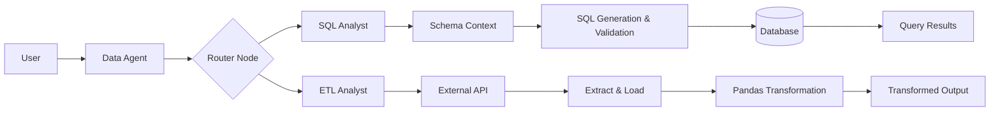

# 🤖 AI Data Agent | Agentic AI for Data Workflows

An LLM-powered multi-agent system that routes natural-language requests to specialized agents for data extraction, transformation, and SQL analysis. Built with **Python, LangChain, LangGraph, and OpenAI**, the project explores how agentic workflows can automate data operations through intelligent routing, tool calling, and structured state management.

## 🏗️ Architecture


The system follows a multi-agent architecture in which a central Data Agent delegates tasks to specialized agents through a routing workflow.



### Core Components

- **Data Agent:** Receives natural-language requests and coordinates task execution.
- **Router Node:** Directs requests to the appropriate specialized agent.
- **SQL Analyst:** Handles database-oriented requests using schema context, SQL generation, validation, and query execution.
- **ETL Analyst:** Coordinates API extraction, data loading, and Pandas-based data transformation.
- **Tool Layer:** Connects agent workflows to external APIs, files, data-processing utilities, and database operations.

## ✨ Key Engineering Capabilities

- **Multi-Agent Orchestration:** Uses LangGraph to organize workflows and route requests between specialized agents.
- **Natural Language to Data Operations:** Uses LLMs to interpret user intent and select appropriate tools.
- **LLM-Assisted ETL:** Integrates API extraction, structured data processing, and natural-language-driven Pandas transformations.
- **AI-Assisted SQL Analysis:** Uses database schema context to support SQL generation and query execution.
- **Structured State Management:** Uses defined schemas to manage information across agent workflows.
- **Modular Architecture:** Separates agent logic, database utilities, ETL tools, and LLM configuration into reusable components.

## 🧰 Technology Stack

| Category | Technologies |
|---|---|
| Language | Python |
| LLM Integration | OpenAI API, LangChain |
| Agent Orchestration | LangGraph |
| Data Processing | Pandas |
| Database | MySQL, where configured |
| Data Validation | Pydantic |
| Environment Management | python-dotenv, uv |
| Version Control | Git, GitHub |

## 🔄 Workflow Overview

**1. Request Interpretation**

The system receives a natural-language request describing a data operation.

**2. Intelligent Routing**

The Data Agent uses the routing workflow to select the SQL Analyst or ETL Analyst.

**3. Context and Tool Selection**

The selected agent gathers the necessary context and invokes the relevant tools.

**4. Execution**

The workflow performs the database operation or data extraction and transformation task.

**5. Result Handling**

The system returns the result or execution status to the caller.

## 💡 Example Applications

| Use Case | Example |
|---|---|
| API Data Extraction | Retrieve API data and save it in a structured file format. |
| Data Transformation | Filter, clean, or transform datasets using Pandas. |
| Database Analysis | Answer analytical questions using generated SQL queries. |
| Workflow Automation | Route different data requests to specialized agents. |

## 📁 Project Structure

```text
AI_Data_Agent/
├── agents/
│   ├── data_agent.py       # Main routing agent
│   ├── etl_analyst.py      # ETL workflow agent
│   └── sql_analyst.py      # SQL analysis agent
├── Models/
│   └── schema.py           # Agent state schemas
├── utils/
│   ├── database.py         # Database utilities
│   ├── etl_tools.py        # ETL operations
│   └── llm_pick.py         # LLM selection
├── docs/
│   └── architecture.png   # Architecture diagram
├── main.py
├── feed_db.py
├── pyproject.toml
├── requirements.txt
├── uv.lock
├── .gitignore
└── README.md
```

*The structure is illustrative. Update it to match the files actually committed to the repository. The architecture image must be saved at `docs/architecture.png` for the image link to render.*

## 🔐 Reliability and Security Considerations

- Keep API keys and database credentials in environment variables.
- Validate generated SQL before executing database operations.
- Use appropriately restricted database permissions.
- Validate input files and generated output paths.
- Treat LLM-generated Python code as untrusted until it has been reviewed and executed in a properly isolated environment.

SQL validation and Python code isolation are separate concerns; neither should be described as fully secure without appropriate implementation and testing.

## 🚀 Future Enhancements

- Sandboxed execution for LLM-generated Python code.
- Automated tests for agent routing and tool execution.
- Stronger SQL validation and database access controls.
- Improved error handling, logging, and observability.
- Support for additional data sources and workflow integrations.
- Evaluation of routing accuracy, execution reliability, latency, and API costs.

## 👨‍💻 Author

**Akshat Singh Rawat**

[GitHub Repository](https://github.com/akshatsinghrawat/AI_Data_Agent)

## 📄 License

No license has been specified. Add an appropriate license if you intend to grant others permission to reuse or distribute this project.
